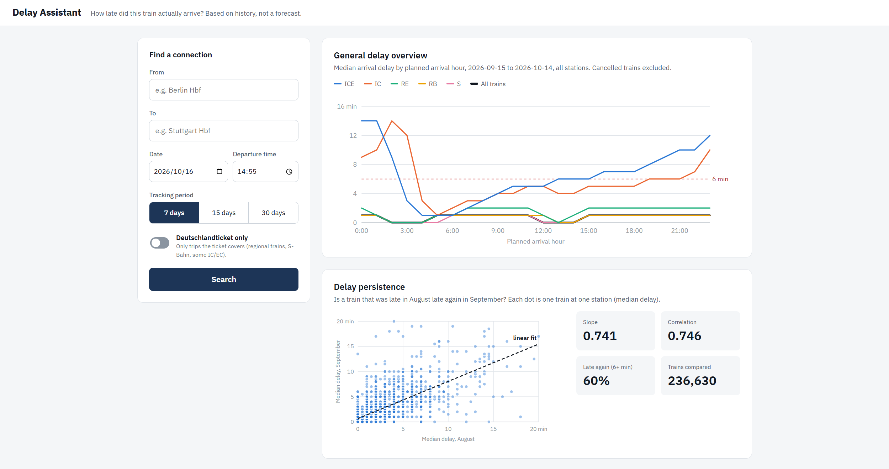
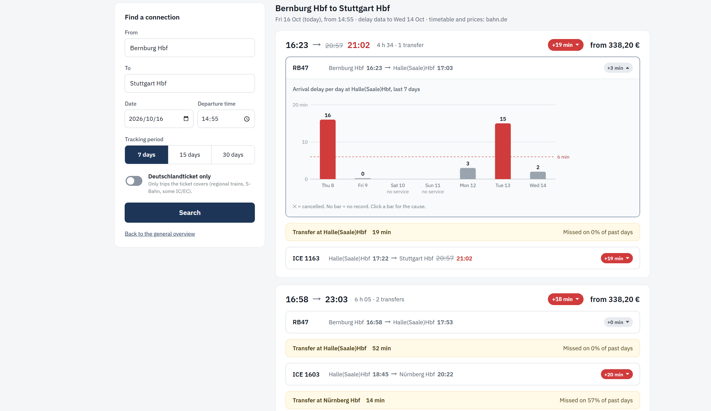
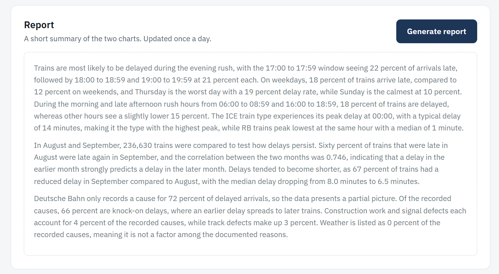
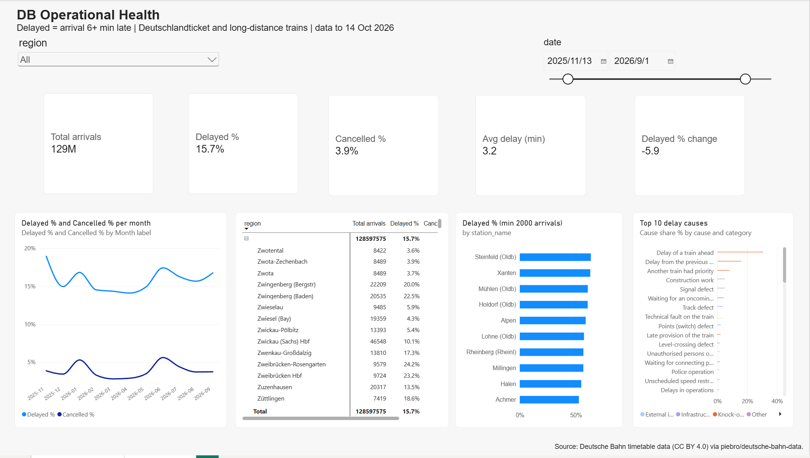
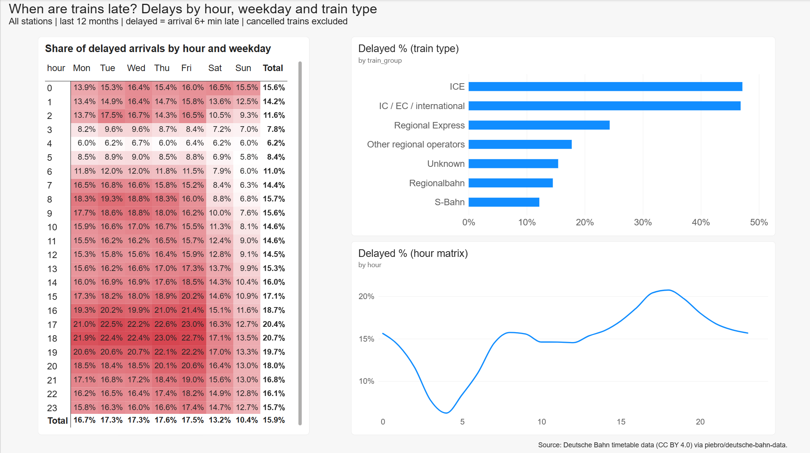

# DB Delay Assistant

A history-based delay assistant for Deutsche Bahn journeys. Enter a start, a destination, a date and a time, and it shows the matching journeys with how late the trains **have been** on those routes over the last 7, 15 or 30 days. It does **not** predict delays; it only reports what happened.

## Screenshots





## What it shows

- **Journey cards** with one badge for the whole journey (median arrival delay of the trip) and a small badge per train.
- **Overview:** delay by hour of the day, and a persistence chart (does a train that is late early on stay late?).
- **Report:** a three-paragraph written summary of the charts, written by an LLM from a fixed list of facts. Any number the model writes that is not in the facts is rejected, and a template text is used instead. If no AI key is set, the template is used.
- **Daily data update:** the history is extended every day from the published raw timetable data.

### Definitions

- **Delay** = arrival delay at the destination of the leg, in minutes.
- **Delayed** = 6 minutes or more.
- The typical delay is the **median**. Cancelled trains are left out of the median but are counted separately; a journey with more than 20 % cancellations gets a "High cancellation" badge.
- Dates before the start of the history return "No records".

## Architecture

```
Hugging Face dataset           daily updater (scripts/daily_loop.py)
piebro/deutsche-bahn-data  ->  raw timetable files -> delays table
                                         |
                                         v
                              data/delays.duckdb  (about 2 GB, one year)
                                         |
FastAPI (src/api)  <- reads ---------------+
   |-- /api/stations, /overview, /persistence, /report, /journeys
   |-- serves the static web page (web/)
   `-- restarts itself when the database file changes
```

- `src/delay_history/` builds and queries the DuckDB delay table and runs the daily update.
- `src/journeys/` finds journeys and joins them with the history.
- `src/api/` is the FastAPI app, the report writer and the file watcher.
- `web/` is the front end (plain HTML, CSS and JavaScript).
- `scripts/` has the update and helper scripts.
- Docker: one image for the app and the updater, `docker-compose.yml` with the services `app`, `updater` and an optional `caddy` for HTTPS.

## Run it

You need [uv](https://docs.astral.sh/uv/) and Python 3.12, or Docker.

```bash
cp .env.example .env        # then set OPENROUTER_API_KEY (optional)
```

**With Docker**

```bash
docker compose up -d
# open http://localhost:8000
docker compose logs updater   # the daily update runs at 04:30 Berlin time
```

**Without Docker**

```bash
uv sync
uv run uvicorn api.app:app --reload
uv run pytest
```

The delay database is not in the repository (it is about 2 GB). The updater builds and extends it from the public dataset; see `scripts/update_data.py` (`--from-day` and `--to-day` rebuild a range).

### Settings (`.env`)

| Variable | Meaning |
| --- | --- |
| `JOURNEY_SOURCE` | `bahn` for real journey search |
| `OPENROUTER_API_KEY` | key for the report text (optional; the template is used without it) |
| `OPENROUTER_MODEL` | model id on OpenRouter |
| `DOMAIN` | only for the HTTPS profile on a server |
| `UPDATE_HOUR`, `UPDATE_MINUTE` | time of the daily update (default 04:30, Berlin) |

## Reporting (Power BI)

Besides the web app, the same delay history feeds an offline **Power BI** dashboard.
`scripts/export_bi.py` writes small aggregated Parquet tables from DuckDB, and Power BI loads them into a star schema
(fact tables for stations, hours and causes; dimensions for stations, dates and causes) with DAX measures
(delayed share, cancellation share, period-over-period change, station ranking).




- **Overview:** KPI cards, weekly or monthly trend, a region -> station drill-down matrix, worst stations, top delay causes.
- **Delay Timing:** weekday x hour heatmap, delay by train family, delay by hour of day.

How to rebuild:

```bash
uv run python scripts/export_bi.py          # writes data/bi/*.parquet
```

Then open `docs/powerbi/db-operational-health.pbix` in Power BI Desktop and refresh. Model and measures are described in
[`docs/POWERBI.md`](docs/POWERBI.md).

## Limits

- History only, no forecast. The number of days is the tracking window you choose.
- Only trains with data in the dataset have history; the data lags about two days behind.
- Journey search uses an unofficial Deutsche Bahn web interface, which can change or block requests.

## Credits and licences

- **Delay data:** Deutsche Bahn timetable data, published under [CC BY 4.0](https://creativecommons.org/licenses/by/4.0/) by DB InfraGO / Deutsche Bahn. Contains changed data; please check the original terms.
- **Raw data collection:** [piebro/deutsche-bahn-data](https://huggingface.co/datasets/piebro/deutsche-bahn-data) (MIT).
- **Reference project:** [sha2nkt/delay_bahn](https://github.com/sha2nkt/delay_bahn), licensed [CC BY-NC](https://creativecommons.org/licenses/by-nc/4.0/). Ideas for the pipeline were taken from it, so this project is **non-commercial**.
- Not affiliated with or endorsed by Deutsche Bahn.

